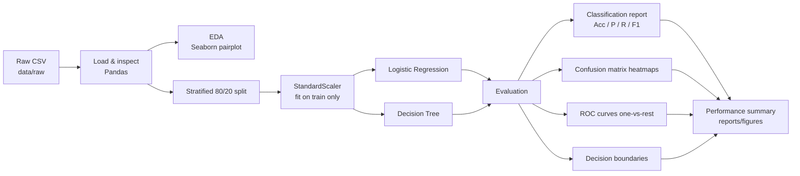
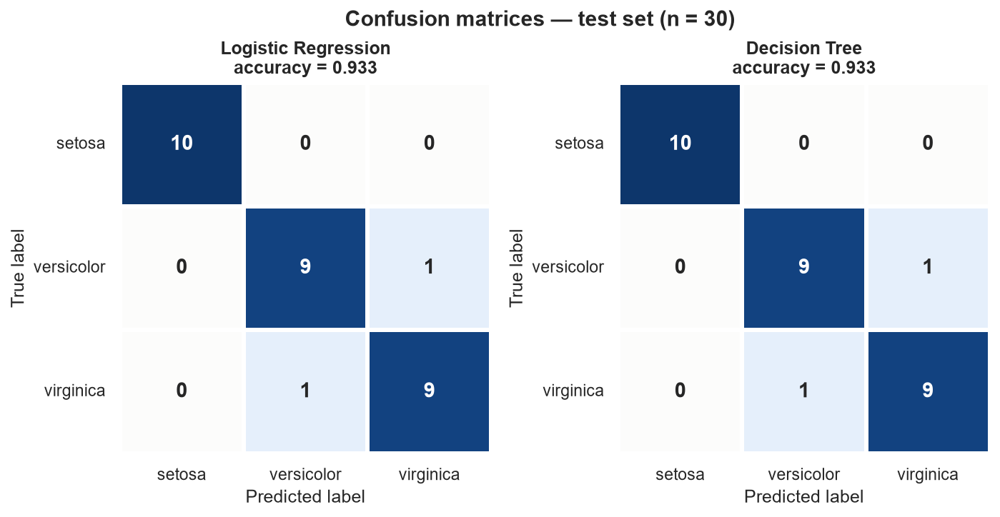
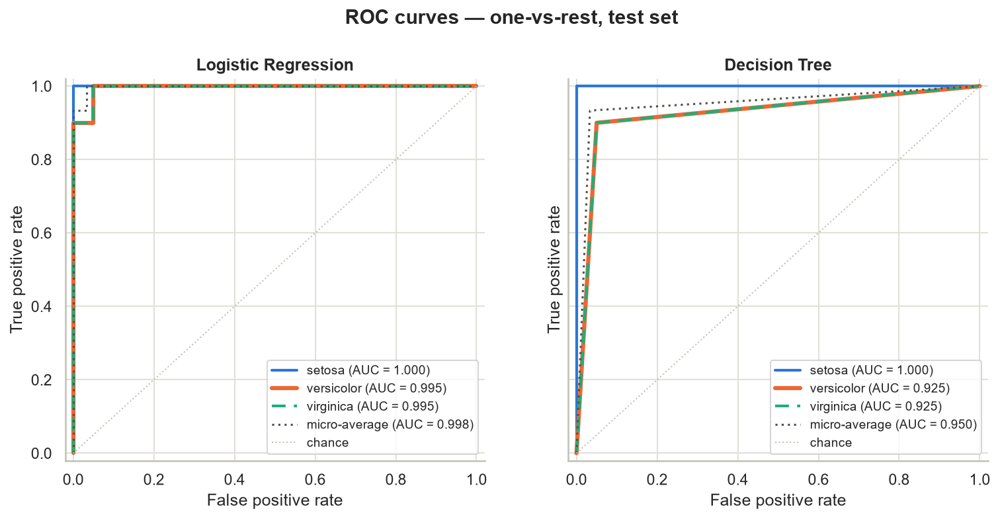
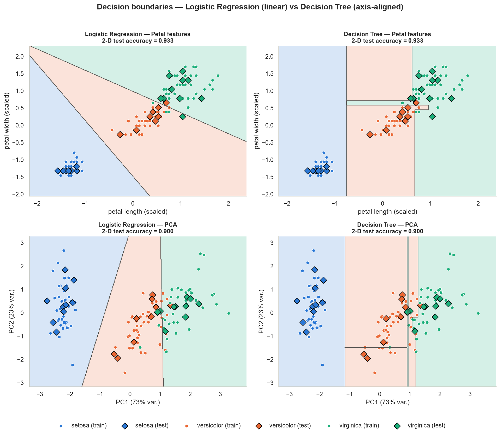
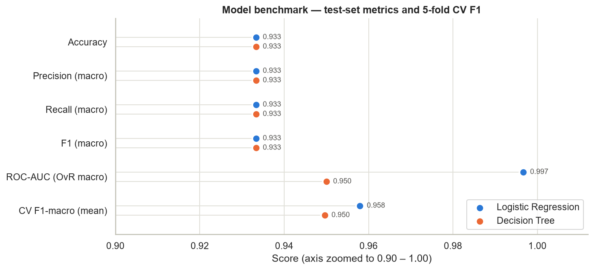

# Task 1 — Multi-Class Benchmark Classification Pipeline (Iris / Wine)

End-to-end supervised classification with Scikit-Learn: EDA, `StandardScaler`,
an 80/20 stratified split, and **Logistic Regression vs. Decision Tree**, benchmarked
on accuracy, precision, recall, F1 and ROC-AUC with confusion-matrix heatmaps,
ROC curves and decision-boundary plots.

**Stack:** Python · Scikit-Learn · Pandas · NumPy · Seaborn · Matplotlib · Jupyter

## Architecture



### Project structure
```
task-01-multiclass-classification/
├── data/
│   ├── raw/                 # original dataset (CSV) — never modified
│   └── processed/           # scaled train/test splits (generated by the notebook)
├── notebooks/
│   └── classification_pipeline.ipynb   # main deliverable
├── reports/
│   ├── figures/             # exported plots (pairplot, confusion matrices, ROC, boundaries)
│   └── performance_summary.csv  # final metrics table
├── src/
│   └── config.py            # paths, target column, split size, random seed
├── requirements.txt
└── README.md
```

## Installation

**Requirements:** Python 3.10+ and Git.

```bash
# 1. Clone the repository
git clone https://github.com/patrira/Datheon-ds-ml-internship.git
cd Datheon-ds-ml-internship

# 2. Create and activate a virtual environment
python -m venv .venv
# Windows (PowerShell)
.venv\Scripts\Activate.ps1
# macOS / Linux
source .venv/bin/activate

# 3. Install dependencies
pip install -r task-01-multiclass-classification/requirements.txt

# 4. Register the Jupyter kernel
python -m ipykernel install --user --name datheon-ml --display-name "Python (datheon-ml)"
```

> On Windows, if PowerShell blocks the activation script, run
> `Set-ExecutionPolicy -Scope Process -ExecutionPolicy RemoteSigned` first.

## Usage

1. The dataset is `data/raw/dataset.csv` (target column `species`, set in `src/config.py`).
2. Start Jupyter: `jupyter notebook` (or open the notebook in VS Code).
3. Open `notebooks/classification_pipeline.ipynb`, select the **Python (datheon-ml)** kernel, then **Run All**.
4. The figures are saved to `reports/figures/`.

## Methodology
1. **Load:** read the CSV with Pandas and check its shape, dtypes, missing values and class balance.
2. **EDA:** draw a Seaborn pairplot coloured by class to see which features separate the classes.
3. **Split:** use `train_test_split(test_size=0.2, stratify=y, random_state=42)`.
4. **Scale:** fit `StandardScaler` on the training set and apply it to both sets, so no test data leaks into training.
5. **Train:** fit `LogisticRegression` (linear) and `DecisionTreeClassifier` (non-linear).
6. **Evaluate:** report accuracy and macro/weighted precision, recall and F1 with `classification_report`.
7. **Visualise:** plot confusion-matrix heatmaps, one-vs-rest ROC curves with AUC, and decision boundaries in 2-D (two features or PCA).

## Results

The dataset is Iris: 150 samples, 4 features and 3 balanced species. Results are on the stratified
30-sample test set, plus 5-fold cross-validation on the training set.

| Model | Accuracy | Precision (macro) | Recall (macro) | F1 (macro) | ROC-AUC (OvR) | 5-fold CV F1 |
|-------|----------|-------------------|----------------|------------|---------------|--------------|
| **Logistic Regression** | 0.933 | 0.933 | 0.933 | 0.933 | **0.997** | **0.958 ± 0.027** |
| Decision Tree           | 0.933 | 0.933 | 0.933 | 0.933 | 0.950 | 0.950 ± 0.017 |

The full table is in [`reports/performance_summary.csv`](reports/performance_summary.csv).

| Confusion matrices | ROC curves (one-vs-rest) |
|---|---|
|  |  |





## Key findings
- **Both models reach 93.3 % test accuracy and make the same two errors.** One versicolor is predicted as
  virginica and one virginica as versicolor. Setosa is classified perfectly.
- **Logistic Regression is the recommended model.** Its ROC-AUC is higher (0.997 vs 0.950), its CV F1 is
  slightly higher, and it generalises consistently (train 0.958 → test 0.933).
- **The Decision Tree overfits.** It reaches 100 % training accuracy, and its boundaries are jagged and
  axis-aligned in the region where versicolor and virginica overlap.
- **Petal length and petal width are the most discriminative features.** Setosa is linearly separable on
  them alone.
- **Limitation:** with 30 test samples, one error moves accuracy by 3.3 points. Next steps: tune the models
  with `GridSearchCV` and benchmark SVM, k-NN and Random Forest.
